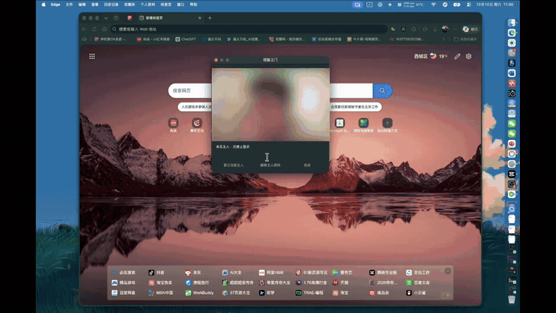

# Window Door · 视窗之门

A free, open-source macOS menu bar utility for viewing a live window through a movable rectangle. Hover to reveal it, move away to hide it, or use optional local camera checks to control when it appears.

[Download](https://github.com/2243181753/window-door/releases/latest) · [中文](README.md) · [Detailed guide (Chinese)](docs/使用指南.md)

Version 1.0.3 · Apple silicon · macOS 14+ · MIT license. Intel builds have not been verified.

## Quick demo



## Features

- Live window capture using ScreenCaptureKit, with an AppKit menu bar interface.
- Move and resize the rectangle while holding Option; follow the target position and size, or track movement while keeping your custom size.
- Active and inactive opacity values. At 0% inactive opacity, the overlay window is hidden and does not accept input.
- Optional background clicks, scrolling, and dragging. Requires Accessibility permission and support from the target app.
- Optional local owner recognition, learned viewing angles, background motion checks, and custom gesture protection.
- Custom shortcuts and settings saved locally.

## Getting started

1. Download `window-door-1.0.3-macos-arm64.zip` from [Releases](https://github.com/2243181753/window-door/releases/latest), extract it, and open the app.
2. Grant Screen Recording permission when prompted.
3. Open the menu bar panel, select a window, and start.
4. For a first test, enable mouse detection, disable camera guarding, and enable opacity switching with minimum 0% and maximum 100%.
5. Hover over the rectangle to reveal it. Move away to hide it.

Camera permission is required only for camera features; Accessibility permission is required for controlling the target window. The overlay pauses when the target window is on top, and resumes when covered if the tool is still started.

## Build

Install Xcode Command Line Tools, then run:

```sh
./build.sh
open 视窗之门.app
```

Run `./test.sh` for tests. The repository includes the SFace model and ONNX Runtime; third-party licenses are in `Resources/Licenses`.

## Limitations and privacy

The distributed app is locally signed and has not been Apple notarized. macOS may restrict opening it. Protected content, minimized windows, and other desktops may have capture limitations. Background input uses a private system interface and may stop working after OS updates or with some apps.

This is a live capture overlay, not a change to the target window's transparency. Hiding the overlay does not hide the original window. Recognition can be wrong and is not a security guarantee.

Screen and camera frames are processed in memory, not recorded or uploaded. Learned profiles and settings stay on your Mac. ONNX Runtime telemetry is disabled.

## License

Project code: [MIT](LICENSE), copyright 2243181753. Third-party models and runtime components retain their own licenses.
