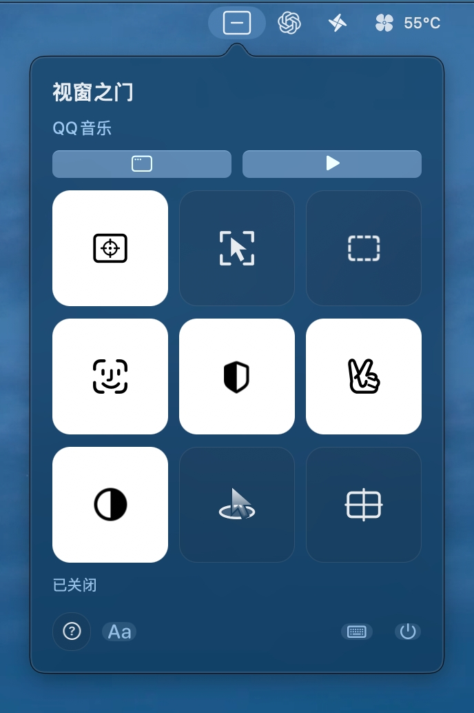
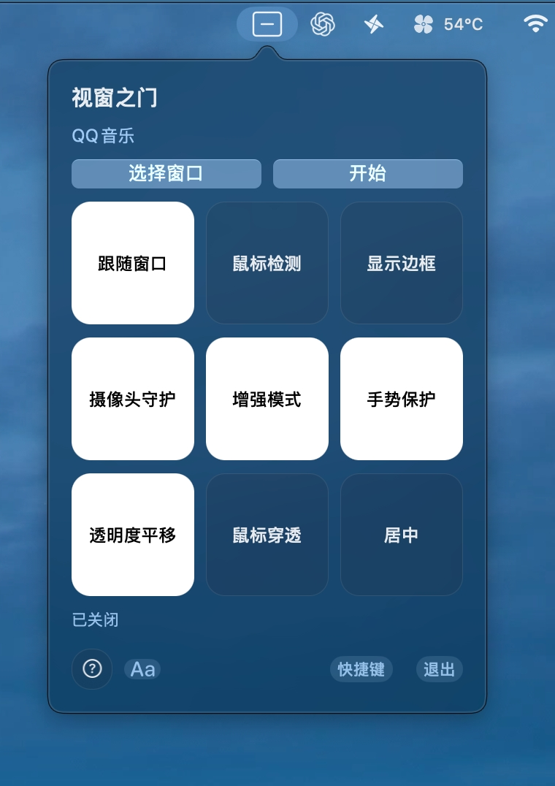

# 视窗之门

适合摸鱼的 macOS 菜单栏小窗工具：把所选窗口的实时画面放进可移动矩形，随时查看、淡显或隐藏。

支持透明度调节、窗口跟随、后台鼠标操作和本机摄像头守护，让临时查看内容更方便。

当前版本：1.0.3。Apple 芯片 Mac，macOS 14 或更新版本。Intel 构建尚未验证。

## 功能

- 选择窗口、实时画面、鼠标悬停激活。
- 跟随窗口的位置和尺寸，或仅跟踪位移、保留自定义大小。
- 最小与最大不透明度；未激活且最小值为 0% 时真正隐藏矩形。
- 按住 Option 拖动矩形或在四角缩放；跟随开启时不进入编辑。
- 后台点击、滚动与拖动；开启鼠标穿透后，按住默认空格可移动目标窗口。
- 本机主人识别、角度学习、背景运动检测与自定义手势保护。
- 条件允许显示时生效的快捷键；设置与学习结果自动保存。

## 下载

[下载最新版本](https://github.com/2243181753/window-door/releases/latest)。选择 `window-door-1.0.3-macos-arm64.zip` 下载软件；源码可通过仓库 Code → Download ZIP，或版本页 Source code 下载。

## 使用教程

第一次使用建议先按 [图文使用指南](docs/使用指南.md) 完成授权和窗口选择，再按需要开启摄像头守护。

[观看 / 下载完整教学视频](https://github.com/2243181753/window-door/releases/download/v1.0.3/window-door-tutorial.mp4)（7 分 25 秒，约 603 MB）。视频与截图由作者提供。

<table>
<tr><th>图标模式</th><th>文字模式</th></tr>
<tr><td></td><td></td></tr>
</table>

点击底部 `Aa` 切换图标与功能名称；白色按钮表示开启，灰暗按钮表示关闭或当前不可用。点击问号开启悬停说明。

## 构建与运行

安装 Xcode Command Line Tools。进入项目目录，执行：

```sh
./build.sh
open 视窗之门.app
```

VS Code 的任务中也提供构建、运行、测试和调试。调试配置需 VS Code 支持 LLDB。

```sh
./test.sh
```

`./verify.sh` 运行源码构建和界面检查。实际摄像头识别、真实鼠标操作及第三方软件兼容性还需手动测试。

仓库包含 SFace 模型与 ONNX Runtime，构建不需要重新下载。模型来源及校验值见 `Resources/model-manifest.json`。

## 权限与限制

屏幕录制用于采集选择的窗口；摄像头用于本机识别；辅助功能（设备控制和数据访问）用于操作目标窗口。首次运行按系统提示授权；修改代码、重新签名后可能需要重新授权。

构建脚本使用本机测试签名，没有 Developer ID 签名或 Apple 公证。下载后的运行体验取决于 macOS 的安全检查；正式分发仍需签名、公证。

最小化、切换桌面或受保护内容可能无法实时采集。后台控制依赖目标应用支持，且使用未公开系统接口，后续系统更新可能影响兼容性；此完整版不适合直接提交 Mac App Store。

矩形隐藏不会隐藏目标应用原始窗口。识别可能误判，不应当作保证安全的身份认证或系统隐私保护机制。

## 本地数据

画面和摄像头帧在内存中处理，不录制、不上传。主人特征、角度、手势和设置存本机；相应学习页面可清除学习资料。ONNX Runtime 遥测已关闭。仓库不包含用户登记资料或运行日志。

## 代码结构

`Sources/HoverPortal` 为 AppKit 界面、ScreenCaptureKit 采集、检测与输入控制；`Sources/FaceRuntime` 为 ONNX Runtime 包装；`Tests` 为验证程序。

## 开源许可

本项目代码采用 [MIT 许可证](LICENSE)，版权归 2243181753。第三方模型、运行库和头文件按 `Resources/Licenses` 中各自的许可证分发，不改变其版权归属。
