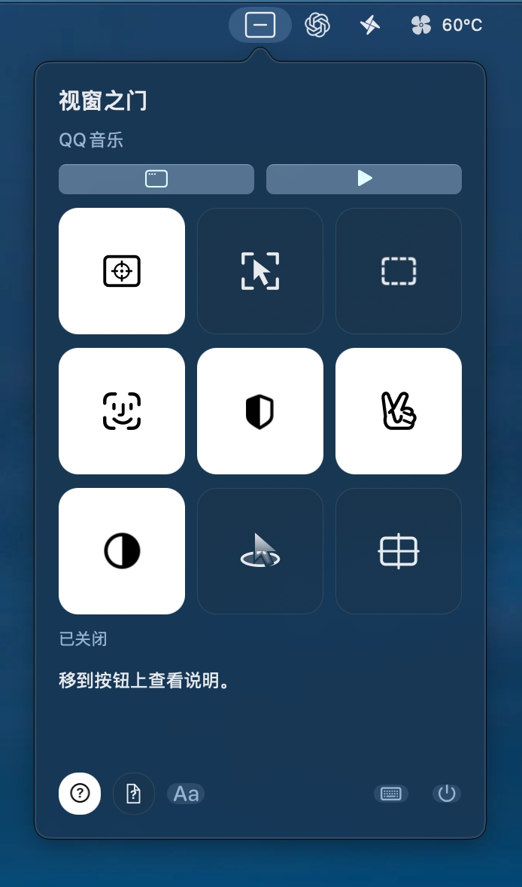
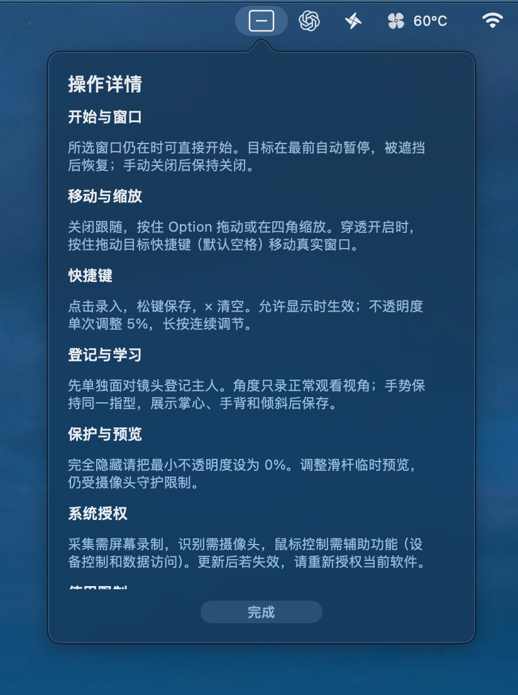

# 视窗之门使用指南

视窗之门适合摸鱼、临时查看视频或其他窗口：所选窗口的实时画面显示在一个小矩形内，可以移动、缩放、调节不透明度，并按鼠标或摄像头条件显示。

它显示的是采集画面。矩形隐藏时，目标应用的原始窗口仍然存在。

[观看 / 下载完整教学视频](https://github.com/2243181753/window-door/releases/download/v1.0.3/window-door-tutorial.mp4)（7 分 25 秒，约 603 MB）。以下图文说明可配合视频阅读。

## 1. 首次启动与授权

1. 从 [最新版本](https://github.com/2243181753/window-door/releases/latest) 下载 Apple 芯片版本，解压并打开“视窗之门”。当前需要 macOS 14 或更新版本。
2. 点击菜单栏的方框图标打开设置。
3. 按系统提示允许屏幕录制，用于显示目标窗口。摄像头守护需要摄像头权限；后台点击、滚动、拖动需要辅助功能权限。
4. 若没有弹出提示，在系统设置 → 隐私与安全性中检查对应权限。不同系统版本的名称可能是“屏幕录制”或“屏幕与系统音频录制”，辅助功能也可能显示为“设备控制和数据访问”。
5. 授权后按系统提示重新打开软件。更新、重新构建或重新签名后，若开关已经打开但仍提示未授权，需要重新核对授权的是当前软件。

下载版尚未经过 Apple 公证；系统可能限制打开。详见主页的 [权限与限制](../README.md#权限与限制)。

## 2. 选择窗口并开始

1. 打开准备查看的目标应用，保持目标窗口存在，先不要最小化。
2. 点击顶部“选择窗口”，选中目标。菜单标题下方会显示所选窗口名称。
3. 点击“开始”。首次选择或重新选择窗口时，矩形按目标窗口的大小调整一次。
4. 初次体验可以关闭摄像头守护，开启“鼠标检测”；鼠标移入矩形显示画面，移出恢复未激活状态。
5. 目标窗口处在最上层时，矩形自动暂停；被其他窗口遮挡后按原条件恢复。手动点击“关闭”后不会自动重新开始。

已选择的窗口仍存在时，下次可以直接开始，不必重复选择。

## 3. 认识九宫格

点击主按钮切换功能。白色表示开启；灰暗表示关闭或不可用。居中是一次性操作。

<table>
<tr><th>图标模式</th><th>文字模式</th></tr>
<tr><td></td><td></td></tr>
</table>

| 位置 | 功能 | 用途 |
| --- | --- | --- |
| 左上 | 跟随窗口 | 同步目标窗口的位置和大小。 |
| 上中 | 鼠标检测 | 要求鼠标在矩形内才允许激活。 |
| 右上 | 显示边框 | 显示或隐藏矩形边框。 |
| 左中 | 摄像头守护 | 根据主人是否在镜头前、是否出现他人决定能否显示。 |
| 正中 | 增强模式 | 增加观看角度与主人区域之外的背景运动检查。 |
| 右中 | 手势保护 | 用手势临时锁定或恢复显示。 |
| 左下 | 透明度平移 | 激活用最大不透明度，未激活用最小不透明度。 |
| 下中 | 鼠标穿透 | 将矩形内的点击、滚动、拖动传给目标应用。 |
| 右下 | 居中 | 将矩形移到屏幕中央。 |

有详细设置的按钮，鼠标移入后会显示简约箭头。点击箭头或右键点击展开；点击卡片外恢复九宫格。没有子设置的按钮不会显示箭头。

底部 `Aa` 切换图标与文字；键盘按钮进入快捷键设置；电源按钮退出软件。

## 4. 移动、缩放与跟踪

### 调整矩形

关闭“跟随窗口”，按住 **Option**：拖动矩形内部移动，拖动四角缩放。调整期间会显示画面，但仍受摄像头守护限制。

开启“跟随窗口”后，大小和位置由目标窗口决定，Option 调整不生效。

### 保留自定义大小，只跟踪位移

关闭“跟随窗口”，展开它的设置，开启“跟踪目标”。矩形保留你设置的大小和相对位置，目标窗口移动时一起移动。

### 移动真实目标窗口

开启“鼠标穿透”，在矩形内按住 **空格**并拖动，可以移动目标应用的真实窗口。空格可在快捷键列表中更改。

## 5. 不透明度

展开“透明度平移”，设置两个滑杆：

- **最大值**：激活时的画面不透明度。
- **最小值**：未激活时的画面不透明度。

想在未激活时完全隐藏矩形，把最小值设为 **0%**。此时矩形窗口真正隐藏，不接收点击；检测仍继续，条件满足后恢复。

最小值大于 0% 时，未激活状态仍会淡显。调整滑杆时临时预览对应值，松开后恢复正常判断；摄像头守护仍然生效。

## 6. 摄像头守护与主人登记

1. 展开“摄像头守护”，点击登记按钮。
2. 确保镜头前只有自己，光线足够、脸部清晰。
3. 点击“登记当前主人”，缓慢略微转脸，等待登记完成，再点击“完成”。
4. 开启摄像头守护。主人不在、识别到他人或摄像头检测异常时，会停止激活。

**鼠标与摄像头的关系：**

- 鼠标检测开、摄像头守护关：鼠标移入即可显示。
- 两者都开：鼠标必须在矩形内，同时满足摄像头条件。
- 鼠标检测关、摄像头守护开：无需悬停，由摄像头条件决定。
- 两者都关：没有激活条件，不会自动显示。

关闭摄像头守护也会关闭依赖它的增强模式和手势保护。

## 7. 增强模式与观看角度

增强模式会检查观看角度，以及主人区域外是否有动静。展开后可学习角度、调整恢复延迟。

### 学习自己的正常观看视角

1. 先登记主人，再打开“学习角度”。
2. 点击“开始学习”，缓慢展示你能够正常看屏幕的姿态，包括实际使用时的小幅转头、抬头、低头。
3. 点击“保存角度”，再点击“完成”。不要录入你希望禁止显示的姿态。
4. 若某个正常姿态遗漏，使用“追加视角”补充；“清除角度”恢复默认角度规则。

学到的是所展示姿态附近的允许范围。学习时保持光照和坐姿接近实际使用环境。角度回到允许范围后，会经过短暂稳定确认再恢复，减少闪烁。

### 恢复延迟

拖动“恢复延迟”滑杆：**0 秒**不额外等待；大于 0 时，出现他人或背景动静后，需要环境持续安全达到设定时间才恢复。角度不符时仍会停止激活。

## 8. 手势保护与自定义学习

开启“手势保护”后，第一次检测到保护手势会立即锁定显示；放下手，再做一次手势可解除锁定。解除时需要主人在镜头前，其他守护条件也必须满足。

展开手势设置可以学习自己的手势：

1. 点击“开始学习”，只举一只手，始终保持同一种伸指组合。
2. 展示清晰掌心、手背和小幅倾斜，让软件采集样本。
3. 等待学习完成，点击“完成”。

一次学习不要混入剪刀手、比六、比八等多个不同动作，否则容易误触发。“清除手势学习”恢复默认剪刀手。手势保护是独立开关，按需要开启。

## 9. 后台鼠标操作与快捷键

开启“鼠标穿透”后，矩形内可以点击具体控件、滚动页面、拖动进度条。它依赖辅助功能权限和目标应用支持，部分应用可能无法正常接收后台操作。

点击底部键盘按钮，进入快捷键列表。点击某一项，按下并松开想使用的组合键即保存；右侧 `×` 清空；“完成”返回菜单。

| 功能 | 初始快捷键 |
| --- | --- |
| 开始 / 关闭 | 未设置 |
| 选择窗口 | 未设置 |
| 跟随窗口 | 未设置 |
| 不透明度 + | 未设置 |
| 不透明度 − | 未设置 |
| 进入编辑（按住） | Option |
| 居中 | 未设置 |
| 透明度平移 | 未设置 |
| 鼠标穿透 | 未设置 |
| 拖动目标窗口（按住） | 空格 |

快捷键受允许显示的条件限制；拖动目标还要求鼠标穿透开启。不透明度每按一次调整 **5%**，长按连续调节。设置和学习结果自动保存在本机，后续启动保留。

## 10. 查看帮助与状态

点击问号开启帮助模式，按钮变亮。把鼠标移到某个按钮上，九宫格下方显示它的简要说明。

问号旁出现带问号的文档图标，点击可查看操作、授权等补充说明。

<table>
<tr><th>悬停帮助</th><th>操作详情</th></tr>
<tr><td></td><td></td></tr>
</table>

未开启帮助时，下方只显示简短状态。菜单栏图标也会指出不能激活的原因，例如主人不在、发现他人、角度不符、手势锁定、背景运动或等待恢复。遇到无法显示，先看这条状态，再检查对应开关。

## 常见问题

**点击开始还是提示授权？** 先确认系统授权的是当前这份软件，再按提示重新打开。重新签名后旧授权可能失效。

**矩形没画面？** 检查是否开始、目标是否在最上层、激活条件和状态提示；尽量让目标窗口保持打开且未最小化。

**点击或滚动没有反应？** 检查鼠标穿透和辅助功能权限。目标应用不支持后台输入时，操作可能受限。

**正常看屏幕却提示角度不符？** 改善光照，使用“追加视角”补录该姿态；避免一次录入过多不相关姿态。

**关闭激活后仍有淡淡的画面？** 把最小不透明度设为 0%。这只隐藏矩形，不会隐藏目标应用原窗口。

屏幕受保护内容、最小化窗口或跨桌面采集可能受 macOS 限制。识别存在误判，不能作为保证安全的身份认证。摄像头画面不录制、不上传，学习资料仅保存在本机。
